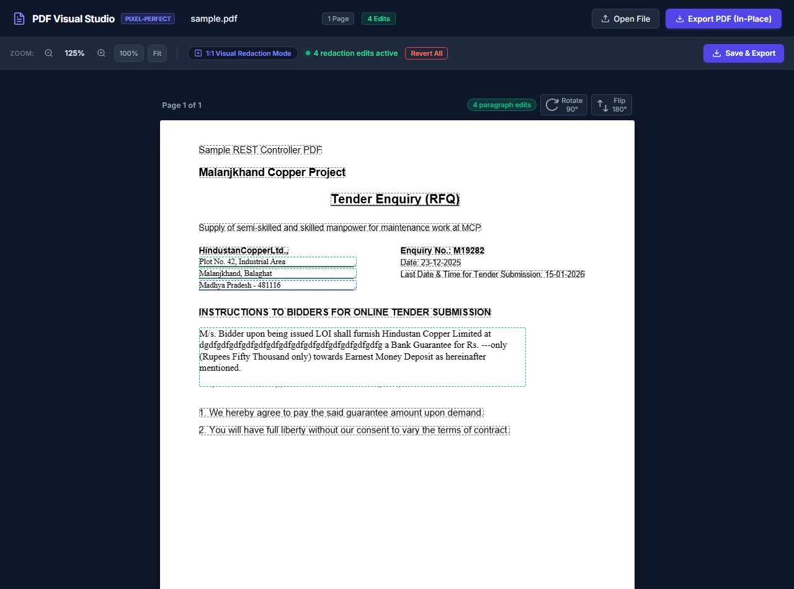
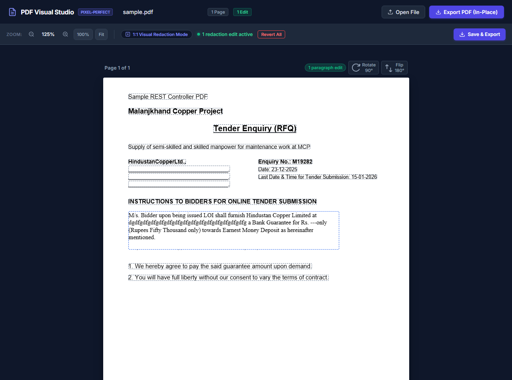
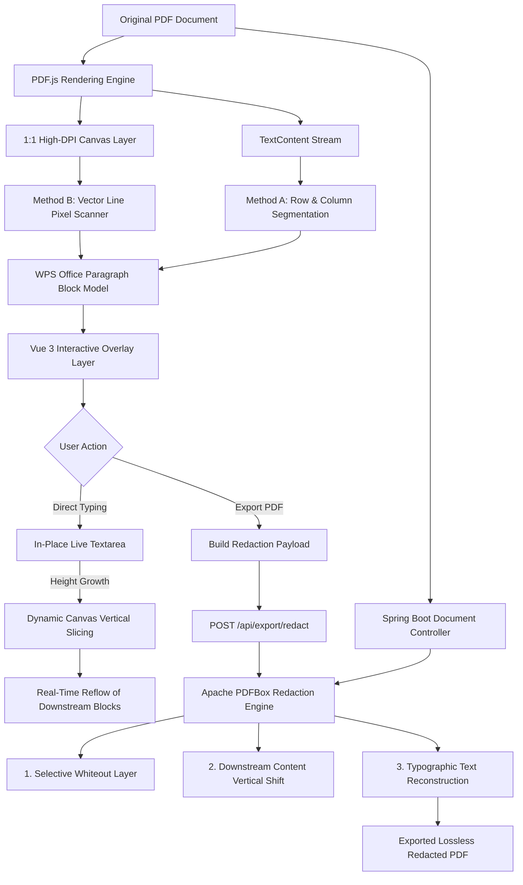

# Whiteforce PDF Visual Studio & Enterprise Resume Redaction Engine

<p align="center">
  
</p>

<p align="center">
  <strong>A modern, pixel-perfect PDF document editor, visual redaction studio, and enterprise B2B Resume PII Redaction & Metadata Extraction API with WPS Office-style live paragraph editing, vertical canvas reflow, and intelligent contact scrubbing.</strong>
</p>

<p align="center">
  <a href="https://github.com/azhardev77/WhiteforcePdf_/actions"></a>
  <a href="https://www.oracle.com/java/technologies/javase/jdk21-archive-downloads.html"></a>
  <a href="https://spring.io/projects/spring-boot"></a>
  <a href="https://pdfbox.apache.org/"></a>
  <a href="https://vuejs.org/"></a>
  <a href="https://vitejs.dev/"></a>
  <a href="https://playwright.dev/"></a>
  <a href="LICENSE"></a>
</p>

---

## 🚀 Enterprise Resume PII Redaction & Metadata Extraction API
For external systems (e.g. Laravel ATS / HRMS portals) integrating with the automated Resume Redaction API:
👉 **[Read the Full Integration Guide (RESUME_REDACTION_API_INTEGRATION_GUIDE.md)](./RESUME_REDACTION_API_INTEGRATION_GUIDE.md)**
- **Endpoints:** `POST /api/v1/resume/process`, `POST /api/v1/resume/extract`, `GET /api/health`
- **Supported Formats:** Single PDF, Multi-PDF batch arrays (`files`), Bulk ZIP archives (`file`)
- **Automated Redaction:** Removes candidate emails, phone numbers, contact icons, and links while preserving surrounding text.

---

## 🌟 Executive Overview

Traditional PDF editors and redaction tools treat PDF text either as isolated single words (causing severe font clipping and overlapping text on neighboring words) or force users into clumsy popup modal dialogues. 

**PDF Visual Studio** breaks this paradigm by implementing a **WPS Office-Style Live Paragraph Block Engine**:
- **Unified Paragraph Grouping**: Rather than fragmented single-word tokens, text lines are intelligently clustered into logical paragraph bounding boxes while preserving multi-column table alignment.
- **Direct In-Place Live Typing**: Click anywhere in a paragraph or form blank to edit directly without popup modals or floating toolbars.
- **Dynamic Vertical Canvas Reflow**: When input exceeds the original paragraph bounding box, downstream page content is smoothly pushed downward using real-time canvas vertical slicing.
- **Dual-Method Blank Line Detection**: Automatically identifies fill-in-the-blank lines and trailing punctuation lines, allowing full-width in-place editing directly above the line without erasing underlying vector underlines.
- **Lossless Backend Redaction & Export**: Powered by Apache PDFBox 3.0 with coordinate matrix rotation handling (0°, 90°, 180°, 270°) and selective whiteout protection.

---

## 📸 Visual Showcase

### 1. Horizontal Blank Line Detection & In-Place Address Form Filling
Full-width editable blocks automatically span column margins, resting directly above vector horizontal lines with transparent background (underlying black lines remain 100% visible):

<p align="center">
  
</p>

### 2. Live Keystroke Reflow & Dynamic Downstream Shift
As new text wraps into multiple lines, paragraph height grows and downstream paragraphs ("1. We hereby agree...") are smoothly shifted down without overlapping:

<p align="center">
  
</p>

---

## ⚡ Key Features

### 🖋️ WPS Office-Style In-Place Paragraph Editor
* **Direct Live Typing**: No clumsy single-word popup modals or floating buttons. Click anywhere to type directly.
* **Intelligent Line Clustering**: Groups text items sharing font metrics and pitch into unified paragraph blocks while strictly respecting table column boundaries.
* **Zero Font Clipping**: Configured with CSS `pre-wrap`, `break-word`, and exact line-height pitch matching so characters never get cropped.
* **Drag & Drop Text Block Repositioning**: Grab handle with 4-way move arrows on hover or selection allows free dragging and repositioning of any paragraph block across the page viewport. Original coordinates maintain an active canvas whiteout mask while PDFBox renders replacement text at the new dropped location.
* **1-Click Revert**: Hover over any edited paragraph to view diff status or click the `×` button to revert to the original text.

### 📐 Universal Blank Line & Fill-in-the-Blank Detection
* **Method A (Text & Whitespace Analysis)**: Retains wide whitespace runs and expands standalone trailing punctuation (e.g. commas `,` or underscores `__`) from column left margins to create full-width editable boxes.
* **Method B (Canvas Vector Stroke Scanner)**: Scans pristine canvas pixels for pure vector strokes (`width >= 55px`, `height <= 4px`) that have no text above, automatically generating editable blocks.
* **"Line Ke Upar" Baseline Placement**: Text baseline sits cleanly above the horizontal stroke with `transparentBackground: true` to prevent whiteout masks from cutting or erasing vector lines.
* **Auto-Clear Punctuation**: Trailing commas are auto-cleared upon clicking so users can immediately type from the left margin.

### 🔄 Real-Time Canvas Vertical Slicing & Reflow
* **Pristine Snapshotting**: Captures an unmutated raster snapshot of the rendered PDF page.
* **Dynamic Slicing**: When an active paragraph expands vertically, the canvas below it is sliced and translated downward by `deltaY` in real-time.
* **Synchronized Overlay**: DOM interactive tokens shift synchronously with the canvas slice.

### 🛡️ Enterprise Lossless PDF Export (Apache PDFBox)
* **Selective Whiteout**: Only erases original text or trailing punctuation while strictly safeguarding underlying border strokes and underlines.
* **Coordinate Transformation Engine**: Converts browser viewport zoom and screen DPI into native unrotated PDF points across 0°, 90°, 180°, and 270° orientations.
* **Proportional Page Shift**: Automatically applies vertical page shifting to lower elements during PDF generation when multiline edits require extra height.

---

## 🏗️ Architecture & Data Flow



---

## 🛠️ Technology Stack

| Layer | Technologies | Purpose |
|---|---|---|
| **Frontend Framework** | **Vue 3** (Composition API, `<script setup>`) | High-performance reactive UI |
| **State Management** | **Pinia** | Centralized reactive document & edit state |
| **PDF Rendering** | **PDF.js v4.10** | 1:1 Browser Canvas rendering & text extraction |
| **Styling** | **Tailored Vanilla CSS** | WPS Office dashed aesthetics, glassmorphism, zero font-clipping |
| **Build Tooling** | **Vite 5.4** | Ultra-fast HMR and optimized production bundle |
| **Backend Framework** | **Spring Boot 3.3.4** | Robust REST API and document pipeline |
| **Language Runtime** | **Java 21 LTS** | High-performance virtual thread capability & record patterns |
| **PDF Manipulation** | **Apache PDFBox 3.0.3** | Lossless vector redaction, typography & PDF export |
| **Testing** | **JUnit 5, MockMvc, Playwright** | 34 backend unit tests & comprehensive E2E automation |

---

## 📁 Repository Structure

```
pdf-editor/
├── backend/                               # Spring Boot 3.3.4 Backend
│   ├── src/
│   │   ├── main/java/com/pdfeditor/
│   │   │   ├── config/                    # CORS & application configuration
│   │   │   ├── document/                  # Document upload, extraction & sample endpoints
│   │   │   ├── export/                    # PdfRedactionService (PDFBox 3.0 redaction & export)
│   │   │   ├── extraction/                # PDF parsing, line detection & block grouping
│   │   │   ├── model/                     # DocumentModel, PageModel, TextRun records
│   │   │   └── render/                    # HTML & CSS document generator
│   │   └── test/java/com/pdfeditor/       # 34 comprehensive JUnit 5 integration & unit tests
│   ├── sample-pdfs/                       # Verified sample PDFs (Tender RFQ, Bank Guarantee)
│   └── pom.xml                            # Maven dependencies & build setup
│
├── frontend/                              # Vue 3 + Vite Frontend
│   ├── src/
│   │   ├── api/                           # Axios REST clients (documents, export)
│   │   ├── components/                    # PdfCanvasEditor.vue (Live WPS paragraph block engine)
│   │   ├── stores/                        # Pinia documentStore (history, zoom, redaction state)
│   │   ├── views/                         # EditorView.vue (Header, toolbar, export controls)
│   │   ├── App.vue                        # Root application shell
│   │   └── main.js                        # App bootstrap & styling imports
│   ├── package.json                       # Frontend dependencies & scripts
│   ├── vite.config.js                     # Vite build & proxy settings
│   └── verify-e2e.cjs                     # Playwright E2E verification test suite
│
├── docs/                                  # Documentation & showcase media
│   └── images/                            # Verified test & UI screenshots
├── sample-pdfs/                           # Root sample PDFs directory
├── verify-e2e.cjs                         # Root-level Playwright test runner
├── package.json                           # Root scripts for concurrent orchestration
└── README.md                              # Project documentation
```

---

## 🚀 Quick Start & Installation

### Prerequisites
- **Java Development Kit (JDK)**: Version 21 or later
- **Apache Maven**: Version 3.8+
- **Node.js**: Version 18.x or later
- **npm**: Version 9.x or later

---

### Option 1: Single-Command Launch (Recommended)

Run both the Spring Boot backend and the Vite frontend concurrently from the root directory:

```bash
# 1. Install root dependencies (concurrently)
npm install

# 2. Start full-stack development environment
npm run dev
```

- **Frontend Application**: [http://localhost:5173](http://localhost:5173)
- **Backend REST API**: [http://localhost:8080](http://localhost:8080)

---

### Option 2: Running Components Separately

#### 1. Backend Service
```bash
cd backend
mvn spring-boot:run
```
*The Spring Boot server will start on port `8080`.*

#### 2. Frontend Development Server
```bash
cd frontend
npm install
npm run dev
```
*The Vite application will start on port `5173` with proxy configuration to the backend.*

---

## 🧪 Testing & Verification

The project includes both comprehensive backend unit/integration tests and an automated end-to-end Playwright test suite:

### 1. Backend Unit Tests (JUnit 5 + MockMvc)
```bash
cd backend
mvn test
```
**Test Results:**
```text
[INFO] Results:
[INFO] Tests run: 34, Failures: 0, Errors: 0, Skipped: 0
[INFO] BUILD SUCCESS
```

### 2. End-to-End Test Suite (Playwright)
Executes a complete headless browser session verifying:
1. **Paragraph-Level Bounding Boxes**: Validates thin dashed border styles (`1px dashed #64748b`) and multi-line grouping.
2. **Direct In-Place Live Typing**: Confirms zero popup modals and automatic targeting of dotted fill-in-the-blank placeholders.
3. **Live Keystroke Reflow**: Tests long string input, dynamic paragraph growth, and smooth downstream shifting.
4. **Horizontal Blank Lines Detection**: Tests 3 address lines under *"HindustanCopperLtd.,"* verifying full-width boxes (>= 150px) and transparent background rendering directly above the lines.
5. **Lossless PDF Export**: Generates and validates the downloaded redacted PDF file.

```bash
# Run Playwright E2E verification
node verify-e2e.cjs
```

**Verification Output:**
```text
=== ALL 5 WPS OFFICE-STYLE PARAGRAPH BLOCK TESTS PASSED 100% ===
[PASS] Requirement 1: Paragraph blocks display WPS Office-style thin dashed borders.
[PASS] Requirement 2: Direct in-place live typing started without any popover modal.
[PASS] Requirement 2a: Paragraph height expanded dynamically (+24.0px, lines increased to 4+).
[PASS] Requirement 2b: Downstream paragraph shifted down smoothly by 24.0px.
[PASS] Requirement 3: Zero font clipping with pre-wrap word wrapping and matching font metrics.
[PASS] Requirement 5a: All 3 blank lines under "HindustanCopperLtd.," have full-width editable boxes.
[PASS] Requirement 5b: Zero whiteout masks placed on blank horizontal lines, keeping black lines visible.
[PASS] Requirement 4: Exported PDF generated and downloaded cleanly.
```

---

## 📡 REST API Reference

### 1. Extract Document Schema
Extracts text runs, lines, tables, and dimensions from an uploaded PDF.
- **Endpoint:** `POST /api/documents/extract`
- **Content-Type:** `multipart/form-data`
- **Request Body:** `file` (Multipart PDF file)
- **Response:** `DocumentModel` JSON containing pages, lines, bounding boxes, and table layouts.

### 2. Export Redacted PDF
Applies in-place text replacements, selective whiteout masks, and coordinate-transformed text drawing.
- **Endpoint:** `POST /api/export/redact`
- **Content-Type:** `multipart/form-data`
- **Parameters:**
  - `file`: Original PDF file
  - `editsJson`: JSON string array of `TextRedactionEdit` objects
- **Response:** `application/pdf` binary stream.

### 3. Load Sample PDF
Fetches pre-bundled sample PDF documents for testing and instant demonstration.
- **Endpoint:** `GET /api/documents/sample/{filename}`
- **Parameters:** `filename` (`sample.pdf` or `tender.pdf`)
- **Response:** `application/pdf` binary stream.

---

## 🗺️ Product Roadmap

- [x] WPS Office-style unified paragraph block grouping.
- [x] In-place direct live textarea typing without floating modals.
- [x] Dynamic vertical canvas reflow via pristine canvas slicing.
- [x] Dual-method blank horizontal line detection (Method A & Method B).
- [x] Transparent background for fill-in-the-blank address lines.
- [x] Multi-angle page rotation support (90°, 180°, 270°).
- [ ] OCR extraction pipeline for scanned, image-only PDF documents.
- [ ] Interactive form field designer (checkboxes, radio groups, date pickers).
- [ ] Digital signature placement with PKCS#7 cryptographic signing.
- [ ] Collaborative multi-user editing via WebSockets / CRDTs.

---

## 📄 License

This project is licensed under the **MIT License** — see the [LICENSE](LICENSE) file for details.

---

<p align="center">
  Crafted with precision by <a href="https://github.com/azhardev77">azhardev77</a>.
</p>
